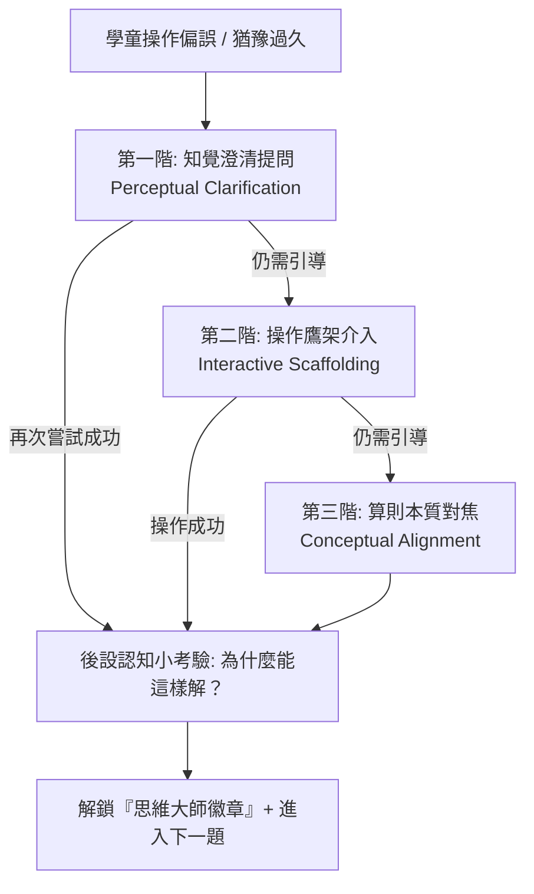
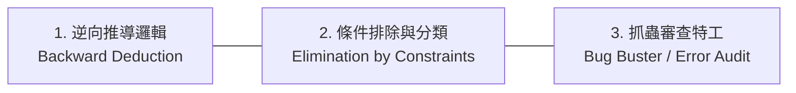
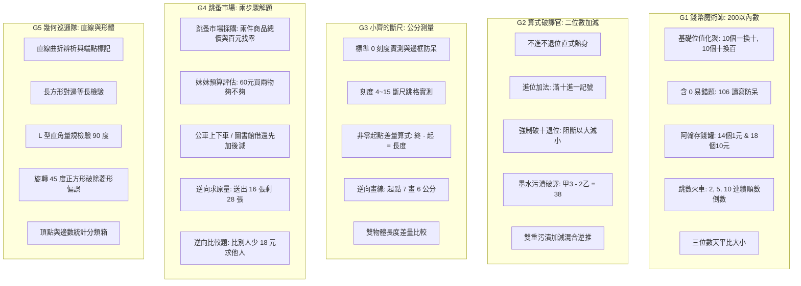

# 國小二年級上學期數學期中複習：GitHub Pages 遊戲化系統開發計畫

## 1. 核心定位與目標
將專案中已沉澱的「翰林二上期中評量研究」與「CPA 遊戲化教學架構」落地為**純前端靜態 Web 遊戲**，託管於 GitHub Pages。目標族群為國小二年級學童（7–8 歲），支援平板觸控操作與無障礙語音引導。

---

## 2. 技術棧與工程架構

| 面向 | 選型 | 說明 |
| :--- | :--- | :--- |
| **框架架構** | Vite + React 18 + TypeScript | 輕量、標準化靜態構建，完全契合 GitHub Pages。 |
| **樣式與排版** | Tailwind CSS + Lucide Icons | 響應式排版，支援行動平板（iPad / Chromebook）大觸控面積。 |
| **動畫與互動** | Framer Motion + HTML5 Pointer Events | 支援物理拖曳、代幣融合、卡槽吸附等動態效果。 |
| **引導式教學引擎** | 自建 Socratic Scaffolding Hook | 三階漸進式提問（現象澄清 $\to$ 操作鷹架 $\to$ 算則歸納），杜絕死記答案。 |
| **無障礙輔助** | Web Speech API (`speechSynthesis`) | **點擊發音朗讀題幹與引導對話**，解決低年級識字障礙。 |
| **音效系統** | Web Audio API (程式合成聲波) | 無需外載大型音訊檔案，提供即時動態提示音（成功音、清脆點擊音）。 |
| **離線快取** | PWA (`vite-plugin-pwa`) | 學校教室連線不穩時仍可本機離線遊玩。 |
| **進度存檔** | LocalStorage | 免登入，本機記住星級、思維勳章與各關卡進度。 |
| **自動化部署** | GitHub Actions Workflow | Push 即自動構建並發佈至 `gh-pages` 分支。 |

---

## 3. 引導式教學體系設計（Socratic Inquiry & 思維小精靈系統）

本系統不採取傳統「直接顯示紅字叉叉或直接給解答」的挫敗模式，而是引入**思考小精靈（Mascot Mentor）**，透過 **蘇格拉底三階提問階梯** 與 **後設認知反思（Metacognition）** 驅動學童深度思考：



### 3.1 三階漸進式提問階梯（以典型錯誤為例）

| 關卡與常見偏誤 | 第一階：知覺澄清（觀察） | 第二階：操作鷹架（動手） | 第三階：算則歸納（抽象） |
| :--- | :--- | :--- | :--- |
| **G1：106 寫成 16** | 語音提問：「看一看十位欄，裡面有一把十元硬幣嗎？」 | 十位欄出現放大鏡高亮空位：「空空的地方，數字精靈該用誰來佔位？」 | 提示「0 的重要性」：「如果沒有 0，16 就變成 1 個十和 6 個一囉！」 |
| **G2：52-27 個位算 7-2=5** | 語音提問：「你有 2 顆糖果，能分給朋友 7 顆嗎？糖果夠不夠？」 | 高亮十位 5 個十元，彈出槌子圖示：「個位不夠了，找十位幫忙敲碎一個十！」 | 直式同步劃斜線：「十位借出 1 個，個位多了 10，現在個位有 12 個，12-7 是多少？」 |
| **G3：斷尺 5~13 直讀 13** | 語音提問：「緞帶的最左邊，是乖乖對齊數字 0 嗎？」閃爍刻度 5。 | 解鎖「跳格筆」：「試著用手指從刻度 5 開始，一步一步跳到 13，數數跳了幾大格？」 | 算式鷹架展開：`[ 13 ] - [ 5 ] = [ ? ]`，「用終點減起點，就是它真正的長度！」 |
| **G4：看到『剩下』直接用減法** | 語音提問：「送人 16 張後還剩下 28 張，小麗原本的貼紙比 28 張更多還是更少？」 | 提供長條積木：「把『送出的16張』和『剩下的28張』拼在一起，看全長是合起來還是切掉？」 | 「要求原本的全部，要把送人和剩下的加回去：16 + 28 = 44！」 |
| **G5：旋轉 45° 正方形看成菱形** | 語音提問：「轉了一點點角度，它的四條邊長度有沒有偷偷變長或縮短？」 | 啟用「L型直角卡規」：「拿量規卡入四個角，看看四個角是不是都直直的？」 | 「四條邊一樣長，四個角都是直角，就算轉個方向，它永遠都是正方形！」 |

### 3.2 通關「後設認知小反思」（Metacognitive Checkpoint）
每完成一道關鍵核心題，系統不立即跳下一題，而是出現 5 秒「思考對話框」：
* 範例題（斷尺題後）：「剛才這道題，為什麼我們不能直接說答案是 13 公分呢？」
  * 選項 A：因為尺很髒。
  * 選項 B：（正解）因為這條緞帶不是從刻度 0 開始量的。
  * 選項 C：因為 13 是不吉利的數字。
* **獎勵機制**：選對後發給「思考徽章」，強化概念內化而非靠運氣過關。

---

## 4. 邏輯推理深化體系（Mathematical Logic & Detective Engine）

為突破低年級學童「死記規則、關鍵字反射」之瓶頸，本系統在五大單元中全面嵌入**三大邏輯思維機制**：



### 4.1 三大核心邏輯機制規劃

1. **逆向推導邏輯（從終點倒推起點）**：
   * **G2 污漬破譯**：已知差量為 38，減數為 25，倒推原始被減數必須是 $38 + 25 = 63$。
   * **G3 逆向找起點**：尺被蓋住一部分，只知終點在刻度 15，物品長 7 公分，倒推起點在 $15 - 7 = 8$。
   * **G4 原始量還原**：送人 16 張剩下 28 張，逆向推理「原本的一定比剩下更多」，必須執行合體 $28 + 16 = 44$。

2. **多條件排除法（幾何與數值偵探）**：
   * **幾何線索題**：
     * 線索 1：「我有 4 條邊。」（排除三角形）
     * 線索 2：「我的 4 個角都是直角。」（排除平行四邊形與一般菱形）
     * 線索 3：「我的 4 條邊長度沒有全部相等。」（排除正方形 $\implies$ 鎖定長方形）
   * 學童透過「點擊刪除不符合的嫌疑圖形」，鍛鍊嚴謹的形式演繹邏輯。

3. **抓蟲特工模式（Bug Buster：尋找矛盾與反例）**：
   * 畫面呈現其他虛擬角色（如糊塗蟲怪獸）做出的錯誤解答，讓學童扮演「邏輯小法官」抓出錯誤破綻：
     * **錯誤範例 A**：直式 $52 - 27 = 35$。學童點擊個位的 5，系統要求回答：「哪裡不合邏輯？」$\to$ 選擇 `[ 2 比 7 小，不能直接用 7 減 2 ]`。
     * **錯誤範例 B**：尺從 3 量到 9，答案寫 9 公分。學童圈出尺的左端，指出：「起點不是 0，長度被算大了！」

4. **因果邏輯鏈拼圖（Reasoning Chain Builder）**：
   * 不只填數字，關鍵題要求學童將「邏輯卡」拖曳組裝成完整的推論鏈：
     * `[ 因為被減數個位 3 < 8 ]` $\to$ `[ 所以必須向十位借 1 當 10 ]` $\to$ `[ 十位剩下 5，個位變成 13 ]` $\to$ `[ 最終算得 乙 = 5 ]`。

---

## 5. 引導式引擎代碼規格 (`src/hooks/useGuidedScaffolding.ts`)

```typescript
import { useState } from 'react';
import { playTTS } from '../speech/tts';
import { playSound } from '../audio/soundFX';

export type ScaffoldTier = 0 | 1 | 2 | 3;

export interface GuidedStep {
  tier1Hint: string;   // 知覺澄清
  tier2Hint: string;   // 操作鷹架
  tier3Hint: string;   // 算則收斂
  reflectionQuestion: {
    prompt: string;
    options: string[];
    correctIndex: number;
  };
}

export const useGuidedScaffolding = (stepData: GuidedStep, onCompleted: () => void) => {
  const [tier, setTier] = useState<ScaffoldTier>(0);
  const [showReflection, setShowReflection] = useState(false);

  const handleIncorrectAttempt = () => {
    playSound('incorrect_gentle'); // 溫柔回彈音，非刺耳報錯音
    const nextTier = Math.min(tier + 1, 3) as ScaffoldTier;
    setTier(nextTier);

    let hint = '';
    if (nextTier === 1) hint = stepData.tier1Hint;
    else if (nextTier === 2) hint = stepData.tier2Hint;
    else if (nextTier === 3) hint = stepData.tier3Hint;

    playTTS(hint); // 語音主動啟發提問
  };

  const handleCorrectAttempt = () => {
    playSound('success_chime');
    setShowReflection(true); // 觸發後設認知反思
  };

  const submitReflection = (selectedIndex: number) => {
    if (selectedIndex === stepData.reflectionQuestion.correctIndex) {
      playSound('badge_unlock');
      setShowReflection(false);
      onCompleted();
    } else {
      playTTS('想一想，再觀察一次剛才的操作喔！');
    }
  };

  return { tier, handleIncorrectAttempt, handleCorrectAttempt, showReflection, submitReflection };
};
```

---

## 6. 五大關卡深度題庫體系（共 40+ 階梯題型 + 參數化生成）

題庫分為「梯度關卡（固定精選情境）」與「無盡模式（參數化隨機生成）」，全面覆蓋易錯盲點：



### 關卡 1：阿翰的零錢罐（單元 1：200以內的數 N-2-1）
| 題號 | 題型名稱 | 題目數據與情境 | 核心認知目標與防呆 |
| :--- | :--- | :--- | :--- |
| **G1-01** | 基礎化聚（個換十） | 8 個十元與 15 個一元 | 圈選 10 個一元融合為 1 個十元 $\to$ 95 元。 |
| **G1-02** | 基礎化聚（十換百） | 13 個十元與 6 個一元 | 圈選 10 個十元融合為 1 張百元鈔 $\to$ 136 元。 |
| **G1-03** | 含「0」陷阱題 | 1 張百鈔、0 個十元、7 個一元 | 定位板十位填 0，防範寫成 17 或 1007。 |
| **G1-04** | 阿翰的存錢罐（經典題） | 1 張百鈔、7 個十元、14 個一元 | $14\text{個}1\text{元} \to 1\text{個}10\text{元} + 4\text{個}1\text{元}$，合為 184 元。 |
| **G1-05** | 小婷的存錢罐 | 18 個十元與 3 個一元 | $18\text{個}10\text{元} \to 180\text{元}$，總計 183 元。 |
| **G1-06** | 順數跳數火車（2的一數） | 186 $\to$ 188 $\to$ [ 190 ] $\to$ 192 $\to$ [ 194 ] | 跨整十與百位邊界的連續進位數數。 |
| **G1-07** | 順數跳數火車（5的一數） | 165 $\to$ 170 $\to$ [ 175 ] $\to$ 180 $\to$ [ 185 ] | 掌握鐘面與錢幣常用的 5 單位進退。 |
| **G1-08** | 跨百倒數火車（10的一數）| 130 $\to$ 120 $\to$ 110 $\to$ [ 100 ] $\to$ [ 90 ] | 克服從三位數降至二位數的跨百認知阻礙。 |
| **G1-09** | 天平比大小（高位優先） | 比較阿翰（184元）與小婷（183元） | 百位十位相同時，比較個位 $4 > 3$。 |
| **G1-10** | 錢幣最少化挑戰 | 湊出 175 元，要求使用最少硬幣與鈔票 | 輸出：1百、1張五十、2個十元、1個五元（或等價分解）。 |

### 關卡 2：算式破譯官（單元 2：二位數直式加減 N-2-2）
| 題號 | 題型名稱 | 算式與情境 | 核心認知目標與防呆 |
| :--- | :--- | :--- | :--- |
| **G2-01** | 進位加法記號 | $47 + 28 = [ 75 ]$ | 個位 $7+8=15$，強制在十位上方點擊標記進位「1」。 |
| **G2-02** | 連續進位至百 | $65 + 35 = [ 100 ]$ | 個位進位、十位滿十再進百，建立百位直式位置。 |
| **G2-03** | 基礎破十減法 | $52 - 27 = [ 25 ]$ | 個位 2 不夠減 7，阻斷 $7-2=5$ 直覺，強制十位借 1 拆為 10。 |
| **G2-04** | 十位借光題 | $63 - 58 = [ 5 ]$ | 個位借 10 得 13-8=5，十位剩 5-5=0，不可寫成 15。 |
| **G2-05** | 差為整十減法 | $84 - 34 = [ 50 ]$ | 個位減完為 0，不可省略個位的 0。 |
| **G2-06** | 墨水污漬：個位破譯 | $[甲]3 - 2[乙] = 38$ 中的［乙］ | $(10+3) - [乙] = 8 \implies [乙] = 5$。 |
| **G2-07** | 墨水污漬：十位還原 | 承上題，推導被減數十位［甲］ | $([甲] - 1) - 2 = 3 \implies [甲] - 1 = 5 \implies [甲] = 6$。 |
| **G2-08** | 加法墨水污漬 | $3[甲] + [乙]8 = 82$ | 個位 $[甲] + 8 = 12 \implies 甲=4$；十位 $3 + 乙 + 1 = 8 \implies 乙=4$。 |
| **G2-09** | 雙重減法污漬 | $7[甲] - [乙]6 = 48$ | 個位 $(10+甲) - 6 = 8 \implies 甲=4$；十位 $(7-1) - 乙 = 4 \implies 乙=2$。 |
| **G2-10** | 連續直式驗算 | 用加法驗算 $63 - 25 = 38$ | 操作直式 $38 + 25 = 63$，體會加減互逆本質。 |

### 關卡 3：小齊的斷尺大冒險（單元 3：公分長度測量 N-2-11）
| 題號 | 題型名稱 | 尺規狀態與數值 | 核心認知目標與防呆 |
| :--- | :--- | :--- | :--- |
| **G3-01** | 標準測量與邊框防呆 | 橡皮擦左端對齊 0 刻度，右端到 5 | 提示「對準 0 刻度線，不是直尺塑膠外框邊緣」。 |
| **G3-02** | 小齊斷尺：緞帶實測 | 尺剩 4~15 刻度；緞帶從 5 到 13 | 阻斷直讀 13，要求輸入差量算式 $13 - 5 = 8\text{ cm}$。 |
| **G3-03** | 斷尺測量：鉛筆實測 | 尺剩 2~12 刻度；鉛筆從 3 到 11 | 拖動放大鏡跳格數出 8 大格，算式 $11 - 3 = 8\text{ cm}$。 |
| **G3-04** | 斷尺測量：蠟筆實測 | 尺剩 6~18 刻度；蠟筆從 8 到 17 | 差量算式 $17 - 8 = 9\text{ cm}$。 |
| **G3-05** | 逆向畫線（指定長度） | 起點在刻度 7，需畫出 6 公分線段 | 算式 $7 + 6 = 13$，終點拉動至刻度 13 放開。 |
| **G3-06** | 逆向找起點 | 終點在刻度 15，長度為 7 公分 | 逆算式 $15 - 7 = 8$，判定起點在刻度 8。 |
| **G3-07** | 雙線段長度比較 | 紅線（4到10 = 6cm）vs 藍線（7到14 = 7cm） | 兩條均非零起點，分別計算後比大小：藍線長 1 公分。 |
| **G3-08** | 線段接接樂（加法） | 綠線 14 公分與橘線 28 公分接在一起 | 長度合成直式計算 $14 + 28 = 42\text{ cm}$。 |
| **G3-09** | 剪緞帶情境（減法） | 一條 50 公分的緞帶，剪掉 16 公分包禮物 | 長度相減直式計算 $50 - 16 = 34\text{ cm}$。 |
| **G3-10** | 生活長度估測 | 課本厚度、門的高度、鉛筆長度的單位判別 | 建立「公分」的心像量感（不混淆毫米與公尺）。 |

### 關卡 4：跳蚤市場採購員（單元 4：兩步驟加減混合 N-2-3）
| 題號 | 題型名稱 | 題幹情境與數值 | 核心認知目標與防呆 |
| :--- | :--- | :--- | :--- |
| **G4-01** | 跳蚤市場：消費總額 | 故事書 36 元、彩色筆 48 元 | 第一步中間量合成：$36 + 48 = 84$ 元。 |
| **G4-02** | 跳蚤市場：找零計算 | 拿 100 元鈔票付上述兩樣商品 | 第二步退位扣款：$100 - 84 = 16$ 元。 |
| **G4-03** | 妹妹預算評估題 | 妹妹有 60 元，想買彩色筆 48 元和筆記本 25 元 | 算出總額 $48 + 25 = 73$ 元，比較 $73 > 60$，判定「不夠（還差13元）」。 |
| **G4-04** | 公車上下車（先減後加）| 原有 32 人，到站下車 14 人，又上車 9 人 | 條形圖分步：先算 $32 - 14 = 18$ 人，再算 $18 + 9 = 27$ 人。 |
| **G4-05** | 班級圖書（先加後減） | 架上 45 本，還回 18 本，被借走 26 本 | 先算 $45 + 18 = 63$ 本，再算 $63 - 26 = 37$ 本。 |
| **G4-06** | 零用錢連減 | 小智有 95 元，買麵包 38 元，買牛奶 25 元 | 先算 $95 - 38 = 57$ 元，再算 $57 - 25 = 32$ 元。 |
| **G4-07** | 逆向求原量（阻斷關鍵字）| 送妹妹 16 張貼紙後，還剩 28 張，原本有幾張？ | 阻斷「剩下就用減」謬誤，長條圖合體：$28 + 16 = 44$ 張。 |
| **G4-08** | 逆向比較（少 $\to$ 加） | 小明有 45 元，小明比小華少 18 元，小華有幾元？ | 阻斷看到「少」就減，基準量還原：$45 + 18 = 63$ 元。 |
| **G4-09** | 逆向比較（多 $\to$ 減） | 小英有 62 顆彈珠，小英比小強多 25 顆，小強有幾顆？ | 釐清被比量關係：$62 - 25 = 37$ 顆。 |
| **G4-10** | 連加情境 | 早餐店買蛋餅 35 元、豆漿 20 元、飯糰 35 元 | 連續加法：$35 + 20 + 35 = 90$ 元（或湊整十策略）。 |

### 關卡 5：幾何巡邏隊（單元 5：直線與平面圖形 S-2-1）
| 題號 | 題型名稱 | 圖形狀態與操作 | 核心認知目標與防呆 |
| :--- | :--- | :--- | :--- |
| **G5-01** | 直線特徵辨析 | 混雜直直線、波浪曲線、折線、弧線 | 點選真正的直線，並說明「直直的、沒有彎曲」。 |
| **G5-02** | 點子圖端點固定 | 在點子板上拖曳直尺連線 | 強制點擊線段兩端標記「端點」，理解線段有起終點。 |
| **G5-03** | 長方形對邊等長檢驗 | 擺正的長方形（寬 4cm、長 7cm） | 拖曳直尺量測上下邊（均7cm）、左右邊（均4cm），驗證對邊相等。 |
| **G5-04** | L 型直角卡規操作 | 將 90° 卡規拖曳卡入長方形四角 | 成功卡入時發出「喀嗒」鎖定音，確認四個角都是直角。 |
| **G5-05** | 旋轉 45° 正方形判定 | 傾斜 45° 的正方形（視覺如菱形） | 先量四邊（均5cm），再用卡規卡四角（均90°），破除「傾斜即菱形」迷思。 |
| **G5-06** | 偽正方形辨析（真菱形） | 傾斜且四邊等長，但角為 60°/120° 的菱形 | 卡規無法密合，引導判定「四角不是直角，所以不是正方形」。 |
| **G5-07** | 三角形頂點與邊 | 標記正三角形與直角三角形的頂點與邊 | 點擊計數：3 個頂點、3 條邊、1 個直角（若為直角三角形）。 |
| **G5-08** | 正方形 vs 長方形分類 | 6 個旋轉不同角度的四邊形放入分類箱 | 根據「四邊等長」或「僅對邊等長」精準歸類。 |
| **G5-09** | 七巧板圖形拼合 | 用 2 個等腰直角三角形拼成正方形 | 幾何守恆感知：理解圖形可由更小的基本形體重組。 |
| **G5-10** | 圖形邊長周長預備 | 正方形邊長 5 公分，四邊合起來共幾公分？ | 連加 $5 + 5 + 5 + 5 = 20$ 公分，銜接乘法前置概念。 |

---

## 7. TypeScript 題庫結構型別定義 (`src/types/question.ts`)

```typescript
export type GameId = 'g1' | 'g2' | 'g3' | 'g4' | 'g5';

export interface BaseQuestion {
  id: string;
  gameId: GameId;
  title: string;
  speechText: string; // 供 Web Speech API 語音朗讀之全文
  difficulty: 1 | 2 | 3;
  // 蘇格拉底三階引導與後設認知設定
  scaffolding: {
    tier1Perception: string; // 第一階：知覺引導
    tier2Action: string;     // 第二階：操作鷹架指示
    tier3Concept: string;    // 第三階：算則本質收斂
    reflection: {
      question: string;
      options: string[];
      correctAnswerIndex: number;
      explanation: string;
    };
  };
}

// G1 錢幣題
export interface G1Question extends BaseQuestion {
  hundreds: number;
  tens: number;
  ones: number;
  targetAmount: number;
  mode: 'regroup' | 'compare' | 'skip_count';
  compareTarget?: { name: string; amount: number };
  skipCountSeries?: (number | null)[];
}

// G2 算式污漬題
export interface G2Question extends BaseQuestion {
  minuend: number;    // 被減數 (如 63)
  subtrahend: number; // 減數 (如 25)
  stains: {
    digitPosition: 'tens' | 'ones';
    target: 'minuend' | 'subtrahend' | 'difference';
    variableName: '甲' | '乙';
    correctValue: number;
  }[];
}

// G3 斷尺題
export interface G3Question extends BaseQuestion {
  rulerMin: number;   // 殘尺起點 (如 4)
  rulerMax: number;   // 殘尺終點 (如 15)
  objectStart: number;// 物件起點 (如 5)
  objectEnd: number;  // 物件終點 (如 13)
  mode: 'measure_diff' | 'draw_ray';
}

// G4 兩步驟題
export interface G4Question extends BaseQuestion {
  scenario: 'market' | 'bus' | 'library' | 'reverse_original' | 'reverse_compare';
  step1: { label: string; num1: number; op: '+' | '-'; num2: number; expected: number };
  step2: { label: string; op: '+' | '-'; num2: number; expected: number };
}

// G5 幾何題
export interface G5Question extends BaseQuestion {
  shapeType: 'square' | 'rectangle' | 'rhombus' | 'triangle';
  rotationDeg: number; // 旋轉角度 (如 45度)
  sideLengths: number[];
  angles: number[];
  requiresLGaugeCheck: boolean;
}
```

---

## 8. 實施時程更新

* **階段一：基礎腳手架、音效/語音模組與引導式思考小精靈引擎（2天）**
  * Vite + React + Tailwind + PWA。
  * `src/audio/soundFX.ts`（程式合成音效）與 `src/speech/tts.ts`（中文女聲朗讀）。
  * 實作 `useGuidedScaffolding.ts` 狀態機與吉祥物對話框。
* **階段二：G1 零錢罐 & G2 算式破譯官（3天）**
  * 實作動態代幣融合、定位板連動。
  * 實作墨水污漬直式還原與強制劃線破十，接入知覺引導對話。
  * 導入「抓蟲特工」錯誤診斷機制。
* **階段三：G3 斷尺大冒險 & G5 幾何巡邏隊（3天）**
  * SVG 動態斷尺跳格筆、差量算式驗證與長度後設反思。
  * 幾何多條件排除法與 L 型直角卡規吸附判定。
* **階段四：G4 跳蚤市場採購員 & 整合上線（2天）**
  * 條形圖 Bar Model 分步過渡量輸入與因果邏輯鏈拼圖。
  * 星星存檔、邏輯思維大師勳章、GitHub Actions 自動構建與 GitHub Pages 驗收。
